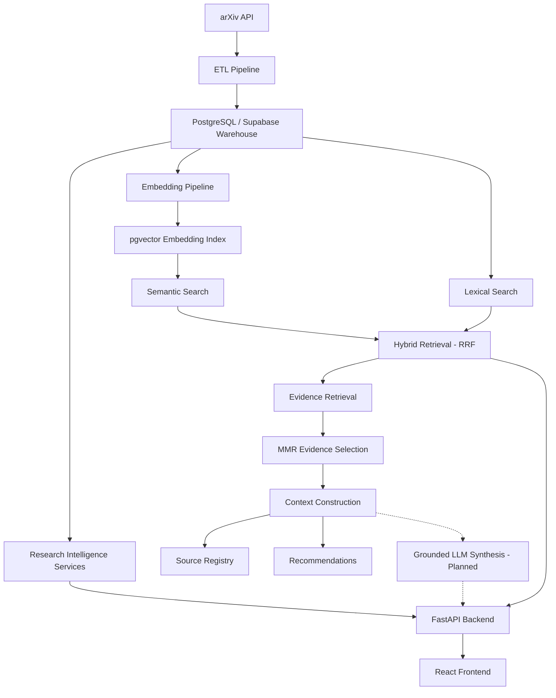

# Analytics Copilot

Analytics Copilot is a full-stack AI research intelligence platform that collects, indexes, analyzes and retrieves research publications from arXiv.

The platform combines automated data engineering, analytical warehousing, semantic retrieval and evidence-based research assistance to help users explore the evolving AI research landscape.

## Capabilities

### Data Engineering

- Automated arXiv ingestion across six AI and machine learning categories.
- Incremental ingestion and historical backfilling.
- Data transformation, validation and deduplication.
- Warehouse-style PostgreSQL data model hosted on Supabase.
- Scheduled ETL execution through GitHub Actions.
- Pipeline monitoring, retry handling and transactional loading.

### Research Intelligence

- Publication trends and research topic analysis.
- Research momentum and growth analysis.
- Topic associations and relationships.
- Category composition and prevalence analysis.
- Interactive evidence exploration and contextual paper discovery.
- Author and publication exploration.

### Information Retrieval

- PostgreSQL full-text search.
- Semantic search using Sentence Transformers and pgvector.
- HNSW approximate nearest-neighbor indexing.
- Hybrid retrieval using Reciprocal Rank Fusion (RRF).
- Experimental cross-encoder reranking.
- Retrieval quality evaluation using relevance judgments, ranking metrics and latency measurements.

### Research Assistant — In Development

- Query-conditioned evidence retrieval.
- Maximal Marginal Relevance (MMR) evidence selection.
- Budget-aware evidence context construction.
- Source registries and retrieval provenance.
- Deterministic further-reading recommendations.
- Grounded LLM synthesis — planned.
- Citation validation and hallucination safeguards — planned.
- Multi-turn research conversations — planned.

## System Architecture



## Technology Stack

| Layer | Technologies |
|---|---|
| Data ingestion | Python, arXiv API |
| Data processing | Python, pandas, NumPy |
| Data warehouse | PostgreSQL, Supabase |
| Vector storage | pgvector, HNSW |
| Embeddings | Sentence Transformers, all-MiniLM-L6-v2 |
| Retrieval | PostgreSQL FTS, cosine similarity, RRF |
| Reranking | BGE cross-encoder (experimental) |
| Evidence selection | Maximal Marginal Relevance |
| Backend | FastAPI |
| Frontend | React, TypeScript |
| Automation | GitHub Actions |
| Dependency management | uv |
| Testing | pytest |

## Project Areas

- `etl/`: ingestion, transformation, validation, warehouse loading and embedding generation.
- `backend/`: API, research intelligence services, retrieval and research assistant foundations.
- `backend/evaluation/`: retrieval quality evaluation.
- `backend/tests/`: backend retrieval and evidence pipeline tests.
- `frontend/`: interactive research intelligence dashboard.
- `sql/`: warehouse schema and analytical queries.
- `data/`: generated pipeline outputs and reports.
- `tests/`: ETL, database and API regression tests.
- `docs/`: system architecture and development roadmap.
- `.github/workflows/`: scheduled pipeline automation.

## Main Workflows

### Install Python dependencies

```bash
uv sync
```

Configure the required database connection credentials before running the pipeline or backend.

### Run the ETL pipeline

From the repository root:

```bash
uv run python -m etl.run_pipeline
```

### Run the backend

```bash
cd backend
uv run uvicorn app.main:app --reload
```

### Run the frontend

```bash
cd frontend
npm install
npm run dev
```

### Run the complete Python test suite

From the repository root:

```bash
uv run python -m pytest -q
```

### Run backend-specific tests

```bash
uv run python -m pytest backend/tests -q
```

## Validation

Latest validation at the completion of Phase 3C.1:

- 278 Python tests passed.
- 28 tests skipped.
- 94 subtests passed.
- 126 evidence pipeline tests passed.
- Live Supabase evidence construction integration passed.

## Documentation

### System Documentation

- [System Architecture](docs/ARCHITECTURE.md)
- [Development Roadmap](docs/ROADMAP.md)

### ETL Documentation

- [ETL Process Guide](etl/ETL_process.md)
- [ETL Overview](etl/docs/etl_overview.md)
- [ETL Data Model](etl/docs/data_model.md)
- [ETL Runbook](etl/docs/etl_runbook.md)

### Frontend Documentation

- [Frontend README](frontend/README.md)

## Current Development Status

The research intelligence and information retrieval foundations are implemented.

Development is currently focused on transforming the retrieval platform into a grounded research assistant capable of synthesizing answers from retrieved scientific evidence.

The current evidence corpus consists of paper titles, abstracts and associated metadata rather than full-text publications.

See the development roadmap for completed milestones, architectural limitations and upcoming work.