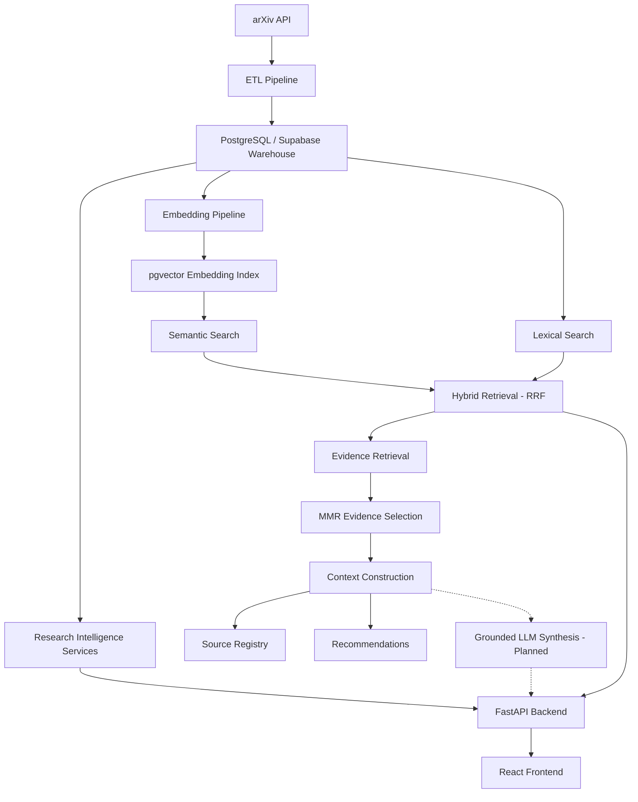

# Analytics Copilot

Analytics Copilot is a full-stack AI research intelligence platform that collects, indexes, analyzes and retrieves research publications from arXiv.

The platform combines automated data engineering, analytical warehousing, semantic retrieval and evidence-based research assistance to help users explore the evolving AI research landscape.

## Capabilities

### Data Engineering

- Automated arXiv ingestion across six AI and machine learning categories.
- Incremental ingestion and historical backfilling.
- Data transformation, validation and deduplication.
- Warehouse-style PostgreSQL data model hosted on Supabase.
- Scheduled ETL execution through GitHub Actions.
- Pipeline monitoring, retry handling and transactional loading.

### Research Intelligence

- Publication trends and research topic analysis.
- Research momentum and growth analysis.
- Topic associations and relationships.
- Category composition and prevalence analysis.
- Interactive evidence exploration and contextual paper discovery.
- Author and publication exploration.

### Information Retrieval

- PostgreSQL full-text search.
- Semantic search using Sentence Transformers and pgvector.
- HNSW approximate nearest-neighbor indexing.
- Hybrid retrieval using Reciprocal Rank Fusion (RRF).
- Experimental cross-encoder reranking.
- Retrieval quality evaluation using relevance judgments, ranking metrics and latency measurements.

### Research Assistant — In Development

- Query-conditioned evidence retrieval.
- Maximal Marginal Relevance (MMR) evidence selection.
- Budget-aware evidence context construction.
- Source registries and retrieval provenance.
- Deterministic further-reading recommendations.
- Grounded LLM synthesis — planned.
- Citation validation and hallucination safeguards — planned.
- Multi-turn research conversations — planned.

## System Architecture



## Technology Stack

| Layer | Technologies |
|---|---|
| Data ingestion | Python, arXiv API |
| Data processing | Python, pandas, NumPy |
| Data warehouse | PostgreSQL, Supabase |
| Vector storage | pgvector, HNSW |
| Embeddings | Sentence Transformers, all-MiniLM-L6-v2 |
| Retrieval | PostgreSQL FTS, cosine similarity, RRF |
| Reranking | BGE cross-encoder (experimental) |
| Evidence selection | Maximal Marginal Relevance |
| Backend | FastAPI |
| Frontend | React, TypeScript |
| Automation | GitHub Actions |
| Dependency management | uv |
| Testing | pytest |

## Repository Layout

```text
backend/app/       FastAPI routes, schemas and database access
  services/
    analytics/     Dashboard, research intelligence and shared research filters
    retrieval/     Lexical, semantic and hybrid search and experimental reranking
    evidence/      Best-chunk retrieval, MMR, assembly, packing and source registry
    agent/         Tokenization, context budgeting and prompt construction
etl/               Ingestion, validation, warehouse loading and embedding indexing
database/          Warehouse DDL, ordered analytics views and archived SQL
evaluation/        Retrieval benchmark code, queries and frozen results
frontend/          React application and frontend tests
tests/             Python suites for backend, ETL, evaluation and integration
docs/              Architecture, roadmap, API, ETL, frontend design and benchmark docs
scripts/           Database deployment and operational validation commands
experiments/       Standalone agent and retrieval prototypes
.github/workflows/ Scheduled ETL and embedding indexing
```

Add HTTP contracts in `backend/app/routes/` and `backend/app/schemas/`. Put
business logic in the relevant service package and Python regressions in the
matching `tests/` subtree. Keep repeatable retrieval measurements in
`evaluation/retrieval/` and exploratory work in `experiments/`.

## Run Locally

From the repository root, install Python 3.12 and the locked dependencies:

```bash
uv python install 3.12
uv sync --locked
```

Python dependencies are declared in `pyproject.toml` and resolved in `uv.lock`.
For local database access, the backend and ETL read `backend/.env` and honor
process environment variables. See the [ETL runbook](docs/etl/etl_runbook.md)
for the required variable names.

Start the API from the repository root:

```bash
uv run uvicorn backend.app.main:app --reload
```

Start the frontend in a separate shell. Set `VITE_API_BASE_URL` to the API URL
(for example, `http://localhost:8000`) when serving the API separately.

```bash
cd frontend
npm ci
npm run dev
```

Run the pipeline and update embeddings from the repository root against the
intended database. Both commands write to the configured database.

```bash
uv run python -m etl.run_pipeline
uv run python -m etl.embeddings.index_papers
```

See the [ETL runbook](docs/etl/etl_runbook.md) for local backfills and the
[architecture guide](docs/ARCHITECTURE.md#repository-boundaries) for
database deployment and benchmark commands.

## Tests

```bash
uv run python -m pytest -q
```

The full suite includes a read-only warehouse connection check. For checks
without a live database, run the backend, ETL and evaluation suites directly.
Tokenizer tests use tiktoken's cache or download the tokenizer assets on
first use.

```bash
uv run python -m pytest -q tests/backend tests/etl tests/evaluation
```

The backend suite also has opt-in PostgreSQL fixture tests. Set
`INTELLIGENCE_SQL_TESTS=1` with database access to run those cases.
For frontend validation, run `npm test`, `npm run lint`,
`npm run typecheck` and `npm run build` inside `frontend/`.

## Documentation

- [System architecture](docs/ARCHITECTURE.md)
- [Development roadmap and Phase 3C.2 checkpoint](docs/ROADMAP.md)
- [Research intelligence API](docs/backend/research_intelligence_api.md)
- [Analytics metrics](docs/backend/analytic_metrics.md)
- [ETL overview](docs/etl/etl_overview.md)
- [Warehouse data model](docs/etl/data_model.md)
- [ETL runbook](docs/etl/etl_runbook.md)
- [Frontend design system](docs/DESIGN_SYSTEM.md)
- [Retrieval benchmark report](docs/evaluation/REPORT_3B5.md)

## Current Checkpoint

Phase 3C.2 is paused immediately before measuring provider-specific chat
token overhead. Model-specific tokenization, context budgeting and prompt
construction have 92 tests. Resume at the checkpoint in the
[development roadmap](docs/ROADMAP.md#phase-3c2--grounded-llm-synthesis).
