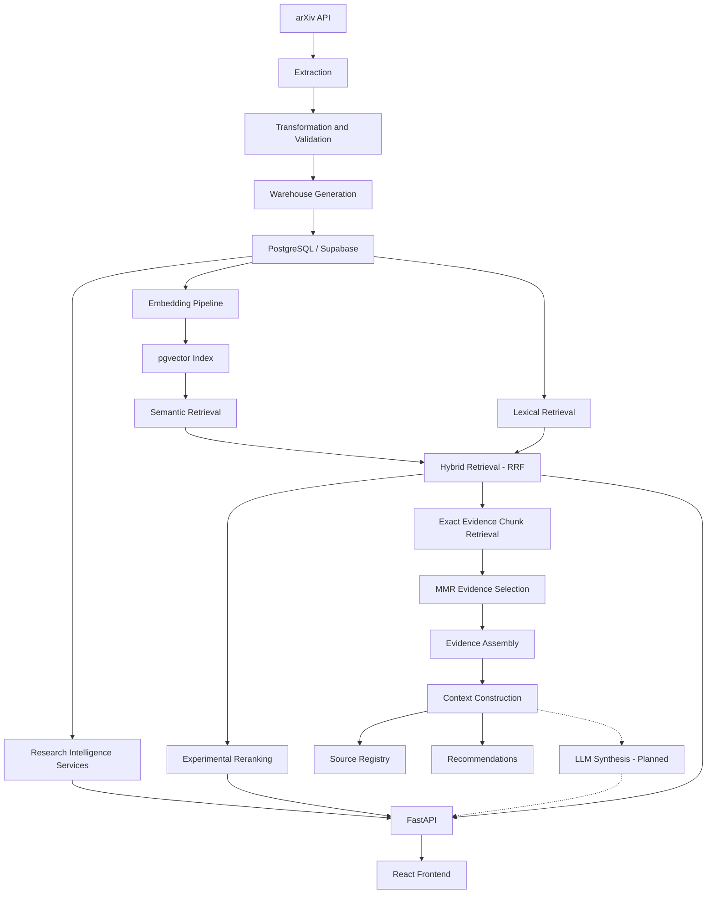
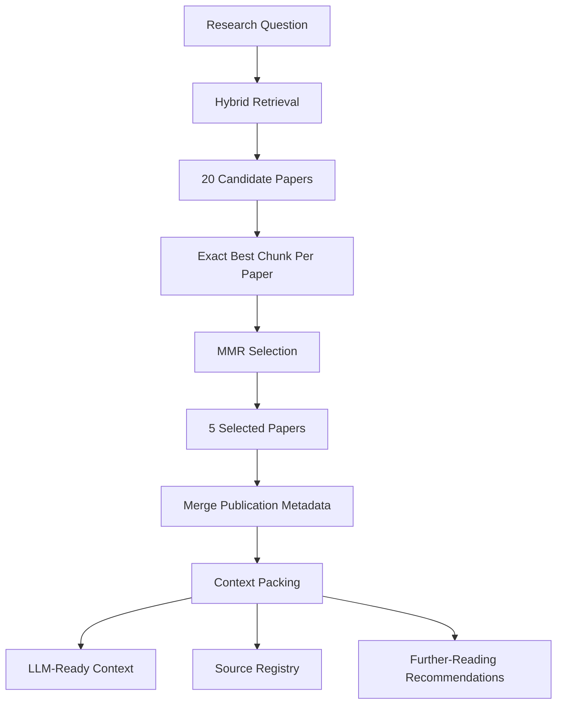

# Analytics Copilot — System Architecture

## 1. Overview

Analytics Copilot is a full-stack AI research intelligence platform designed to collect, organize, analyze and retrieve scientific publications from arXiv.

The system combines traditional data engineering and analytical warehousing with semantic information retrieval and the foundations of retrieval-augmented generation (RAG).

### Design Objectives

- Automate research publication ingestion.
- Maintain a consistent and queryable research warehouse.
- Provide meaningful analytical insights into AI research trends.
- Support both lexical and semantic publication discovery.
- Retrieve relevant and diverse evidence for research questions.
- Enable grounded research assistance with traceable citations.
- Maintain modularity, reproducibility and testability across components.

## Repository Boundaries

- `etl/` ingests and loads warehouse facts and dimensions, then indexes
  embeddings. The scheduled workflow runs both entry points from the repository
  root. Warehouse DDL and analytics view definitions live in `database/`.
- `backend/app/` exposes FastAPI contracts in `routes/` and `schemas/` and
  owns database access. `services/analytics/` reads warehouse views and
  defines research filters. `services/retrieval/` implements lexical and
  semantic search, hybrid rank fusion and experimental cross-encoder reranking.
- `services/evidence/` consumes retrieval results, finds the best chunks,
  applies MMR and assembles evidence. It packs the context with a caller-provided
  token counter and budget. `services/agent/` owns model-specific tokenization,
  context-window budgeting and chat prompt construction.
- `frontend/` consumes the HTTP API. `evaluation/retrieval/` measures ranking
  quality from frozen benchmark inputs and can collect new rankings through the
  API. Early prototypes live in `experiments/`.
- `tests/` is the root Python test hierarchy. `tests/backend/` contains service
  and ASGI tests, including existing opt-in SQL fixtures that share test setup.
  ETL regressions, evaluator tests and the live warehouse check have dedicated
  `etl/`, `evaluation/` and `integration/` subdirectories.

Run the evaluator with `uv run python -m evaluation.retrieval.evaluate`.
Run operational commands from the repository root with `uv run python -m
scripts.validate_views` or `uv run python -m scripts.validate_dashboard_api`.
The deployment command `uv run python -m scripts.deploy_views` applies the
ordered SQL files in `database/analytics/` to the configured database.
The [README](../README.md) has the local startup commands.

## 2. High-Level Architecture



The architecture separates data ingestion, analytical processing, retrieval, evidence construction and presentation into distinct layers.

## 3. Data Engineering Layer

### 3.1 Data Source

The primary data source is the arXiv API.

The ingestion pipeline targets the following research categories:

| Category | Research Area |
|---|---|
| cs.AI | Artificial Intelligence |
| cs.LG | Machine Learning |
| cs.CL | Computation and Language |
| cs.CV | Computer Vision and Pattern Recognition |
| cs.RO | Robotics |
| stat.ML | Machine Learning (Statistics) |

Publications may belong to multiple categories.

### 3.2 ETL Pipeline

The ETL pipeline consists of the following logical stages:

1. Extract publication metadata from arXiv.
2. Transform and normalize publication records.
3. Validate data quality and required fields.
4. Generate warehouse-compatible records.
5. Load records and relationships into PostgreSQL.
6. Record pipeline execution metadata.

The pipeline supports scheduled incremental ingestion and historical backfilling.

### 3.3 Reliability

Reliability mechanisms include:

- Request timeouts.
- Retry handling for transient HTTP failures.
- Exponential backoff.
- HTTP Retry-After handling.
- Request pacing.
- Pagination validation.
- Duplicate handling.
- Transactional database loading.
- Pipeline failure reporting.

Incomplete extraction is treated as a pipeline failure rather than silently publishing partial results.

### 3.4 Automation

GitHub Actions provides scheduled execution of the ingestion pipeline.

The pipeline can also be executed manually for development, maintenance and historical ingestion.

See the [ETL overview](etl/etl_overview.md) for stage inputs, outputs and failure behavior.

## 4. Data Warehouse

### 4.1 Storage

The system uses PostgreSQL hosted on Supabase.

PostgreSQL serves as both the analytical warehouse and the vector retrieval store through the pgvector extension.

### 4.2 Logical Data Model

The warehouse follows a dimensional model with publication facts, descriptive dimensions and many-to-many relationships.

| Table | Responsibility |
|---|---|
| fact_papers | Publication metadata |
| dim_author | Author records |
| dim_category | arXiv research categories |
| dim_topic | Research topic definitions |
| paper_authors | Publication-author relationships |
| paper_categories | Publication-category relationships |
| paper_topics | Publication-topic relationships |
| paper_embedding_chunks | Embedded publication text chunks |

This structure supports analytical aggregation without requiring publication metadata to be duplicated across every relationship.

### 4.3 Publication Identity

Publication identifiers are preserved throughout ingestion, retrieval and evidence construction.

Versioned arXiv identifiers are retained in evidence metadata and source registries to preserve the identity of the retrieved publication.

### 4.4 Database Access

Database access is encapsulated within backend services.

The backend uses connection pooling, parameterized SQL and transaction management.
Importing the application does not load database settings or open a connection.
FastAPI starts the process pool during lifespan startup and closes it during
shutdown. Standalone pooled consumers open it on first use and close it after
all checkouts return. The validation scripts handle this cleanup in their
entry points. The deployment script owns a separate connection for its
explicit transaction.

Database failures are distinguished from legitimate empty query results.

## 5. Research Intelligence Layer

The research intelligence layer provides structured analytical insights derived from the warehouse.

### 5.1 Publication Trends

Tracks publication volume over time and across research categories and topics.

### 5.2 Research Momentum

Measures changes in research activity across comparable time windows.

The analytical implementation accounts for partial periods, zero baselines and incomplete observation windows.

### 5.3 Topic Associations

Analyzes relationships between research topics through shared publications and association measures such as Jaccard similarity.

### 5.4 Category Composition

Examines the distribution and prevalence of research topics across publication categories.

### 5.5 Evidence Exploration

Analytical visualizations support inspection of the publications contributing to their results.

Evidence exploration preserves relevant analytical context, including date windows, topic selections and category scope.

### 5.6 Analytical Correctness

The analytical layer emphasizes:

- Explicit date boundaries.
- UTC-consistent time windows.
- Correct aggregation denominators.
- Distinct publication counting.
- Deterministic filtering and pagination.
- Explicit handling of empty and incomplete periods.

These guarantees are particularly important when publications belong to multiple categories or topics.

## 6. Information Retrieval Layer

The retrieval layer supports lexical, semantic and hybrid publication discovery.

### 6.1 Lexical Retrieval

PostgreSQL full-text search provides keyword-based retrieval.

Lexical retrieval is useful for exact terminology, technical identifiers and explicitly named concepts.

### 6.2 Semantic Retrieval

Semantic retrieval uses the following embedding model:

`sentence-transformers/all-MiniLM-L6-v2`

Publication text is represented using normalized 384-dimensional embeddings.

ETL indexing, semantic queries and evidence retrieval use the shared index
settings in `database/embedding_config.py`. The current embedding index uses:

- Chunk size: 200 tokenizer tokens.
- Chunk overlap: 30 tokenizer tokens.
- L2-normalized embeddings.
- Versioned embedding index identifiers.

The current index identifier is:

`sentence-transformers/all-MiniLM-L6-v2::chunk-200::overlap-30::normalized::v1`

Embeddings are stored in PostgreSQL using pgvector.

### 6.3 Approximate Nearest-Neighbor Search

HNSW indexing supports efficient semantic retrieval.

Semantic retrieval operates over publication chunks and consolidates matching chunks into publication-level results.

An exact retrieval fallback is available in the semantic search implementation.

### 6.4 Hybrid Retrieval

Hybrid retrieval combines lexical and semantic rankings using Reciprocal Rank Fusion (RRF).

For a publication d:

```text
RRF(d) = sum(1 / (k + rank_i(d)))
```

The current RRF constant is 60.

RRF avoids directly combining lexical and semantic scores that may have incompatible numerical scales.

Hybrid retrieval is the default retrieval strategy for the research assistant.

### 6.5 Experimental Reranking

A BGE cross-encoder reranking stage has been implemented for experimental evaluation.

Unlike bi-encoder retrieval, cross-encoder reranking jointly evaluates the query and candidate text.

This can improve ranking quality at the cost of additional inference latency.

Reranking is not the default research assistant retrieval strategy because the initial evaluation showed a relatively small ranking improvement compared with its additional latency.

### 6.6 Retrieval Evaluation

Retrieval evaluation compares:

- Lexical retrieval.
- Semantic retrieval.
- Hybrid retrieval.
- Hybrid retrieval with cross-encoder reranking.

Evaluation metrics include precision, normalized discounted cumulative gain and retrieval latency.

The initial evaluation dataset contains 12 research queries.

The relevance judgments are predominantly provisional model-generated labels, with a smaller human-reviewed subset. Evaluation findings should therefore be treated as preliminary rather than definitive ground truth.

## 7. Research Assistant Foundations

The research assistant uses a retrieval-augmented generation architecture.

The evidence preparation layer is implemented independently of any particular generation model.

### 7.1 Evidence Pipeline



The default candidate and evidence limits are configurable.

### 7.2 Query-Conditioned Evidence Retrieval

Hybrid retrieval first produces a ranked collection of candidate publications.

For each candidate, the system retrieves the most relevant embedded chunk using exact cosine distance against the query embedding.

This provides a query-conditioned representation of each publication rather than relying on a single static publication embedding.

The evidence retrieval stage preserves:

- Publication identifier.
- Matching chunk index.
- Matching chunk text.
- Query similarity.
- Original hybrid retrieval rank.

### 7.3 Maximal Marginal Relevance

Maximal Marginal Relevance (MMR) balances query relevance against redundancy among selected evidence.

```text
MMR(d) = lambda * similarity(q, d)
         - (1 - lambda) * max_similarity(d, selected)
```

The first evidence item is selected using the highest query similarity.

Subsequent items are selected using the MMR objective.

Current provisional defaults:

| Parameter | Value |
|---|---:|
| Hybrid candidate limit | 20 |
| Evidence limit | 5 |
| Relevance weight | 0.7 |

Because embeddings are normalized, dot products can be used to calculate cosine similarity between evidence vectors.

MMR is intended to improve evidence diversity, but it does not guarantee complete coverage of every aspect of a research question.

### 7.4 Evidence Assembly

Selected evidence chunks are merged with their corresponding publication metadata.

The assembly layer preserves:

- Publication identity.
- Original retrieval rank.
- MMR selection rank.
- Matching chunk provenance.
- Similarity scores.
- Publication title and abstract.
- Publication URLs.

Raw embedding vectors are removed from assembled evidence.

The assembly result separates selected evidence from remaining retrieval candidates.

### 7.5 Evidence Content

Although chunk embeddings are used for retrieval and selection, the generation context uses complete original abstracts.

This avoids exposing tokenizer-decoded chunk artifacts and incomplete sentence fragments to the generation model.

Matching chunk information remains available as retrieval provenance.

The current corpus does not contain full-text publications.

Consequently, the assistant must not imply that it has inspected complete paper methodologies, experiments or conclusions beyond the available abstracts.

### 7.6 Context Construction

Context construction is implemented in `backend/app/services/evidence/evidence_budget.py`.

The context builder receives:

- Assembled evidence.
- A caller-supplied context budget.
- A token-counting function.
- A configurable recommendation limit.

The packing algorithm processes selected papers in MMR order.

For each paper:

1. Assign a prospective source identifier.
2. Format the publication title, identifier and complete abstract.
3. Calculate the cost of the resulting combined context.
4. Include the publication if the context remains within budget.
5. Otherwise, move it to overflow and continue processing.

The algorithm does not truncate abstracts.

Source identifiers remain contiguous even when publications are skipped.

Token counting is injected as a dependency so the packing logic remains independent of the eventual generation model.

### 7.7 Source Registry

Included publications are assigned source identifiers such as S1, S2 and S3.

The source registry maps each identifier to explicit publication metadata and retrieval provenance.

Example:

```json
{
  "S1": {
    "paper_id": "2611.04493v1",
    "title": "Example research publication",
    "arxiv_url": "https://arxiv.org/abs/2611.04493v1",
    "pdf_url": "https://arxiv.org/pdf/2611.04493v1",
    "selection_rank": 1,
    "retrieval_rank": 9,
    "chunk_index": 1,
    "similarity": 0.6962
  }
}
```

Only publications included in the generation context receive source identifiers.

Source registry membership establishes whether a citation refers to an available source. It does not establish whether that source supports a particular generated claim.

### 7.8 Further-Reading Recommendations

Recommendations are generated deterministically from:

1. Selected evidence that exceeded the context budget.
2. Remaining hybrid retrieval candidates.

Overflow evidence receives priority.

Recommendations are returned separately from the generation context and do not consume LLM input tokens.

The default recommendation limit is five.

### 7.9 Service Responsibilities

| Module | Responsibility |
|---|---|
| semantic_search.py | Semantic retrieval and query embeddings |
| hybrid_search.py | Lexical and semantic rank fusion |
| reranking.py | Experimental cross-encoder reranking |
| evidence_retrieval.py | Exact query-conditioned chunk retrieval |
| evidence_selection.py | MMR selection |
| evidence_assembly.py | Evidence orchestration and metadata assembly |
| evidence_budget.py | Context packing, source registry and recommendations |

## 8. Research Agent Foundations

The generation layer will consume the prepared evidence context and produce grounded research answers.

The agent service package contains `tokenization.py`, `context_budget.py`
and `prompt_builder.py`. The budget accepts a caller-supplied formatting
allowance. The next measurement will calibrate that allowance against a
provider's reported prompt-token usage. Provider integration, structured
answer generation and citation validation remain planned.

### 8.1 Context Budget Management

The available evidence budget will be determined from the selected model's context capacity and application requirements.

The calculation must account for system instructions, the user question, conversation history, output allowance, message formatting and safety margins.

An application-level context cap may also be used.

### 8.2 Citation Validation

Citation validation will distinguish between:

- Referential integrity: whether a cited source identifier exists.
- Semantic support: whether the cited evidence supports the associated claim.

These are separate correctness requirements.

### 8.3 Insufficient Evidence

Retrieval results do not necessarily imply that a question is answerable.

The assistant must distinguish between relevant evidence, insufficient evidence and questions outside the available research corpus.

### 8.4 Conversation Management

Future multi-turn support will introduce conversation state, follow-up query interpretation and context management.

The current evidence pipeline is stateless.

## 9. Backend API

FastAPI provides the application interface between the frontend and backend services.

The backend separates route handling, validation, service logic and database access.

Existing API functionality includes research analytics, publication exploration and information retrieval.

Research assistant endpoints will be introduced after the generation and validation layers are implemented.

## 10. Frontend

The frontend is implemented using React and TypeScript.

It provides interactive research analytics, publication discovery and evidence exploration.

The frontend design system and existing interaction patterns should be preserved when introducing research assistant functionality.

Planned research assistant functionality includes:

- Research question submission.
- Grounded answer presentation.
- Interactive citations.
- Source inspection.
- Further-reading recommendations.
- Multi-turn conversation support.

## 11. Testing and Evaluation

The project uses pytest for Python testing.

Test coverage includes:

- ETL reliability and failure handling.
- Database transaction and connection management.
- Analytical query correctness.
- API validation and serialization.
- Semantic and hybrid retrieval.
- Retrieval evaluation.
- Evidence retrieval and MMR selection.
- Context packing and source registry integrity.

Repository-wide Python tests can be executed using:

```bash
uv run python -m pytest -q
```

The frontend has its own testing and build validation workflows.

Live integration checks complement mocked unit tests by validating actual database behavior and metadata contracts.

## 12. Architectural Decisions

| Decision | Rationale |
|---|---|
| PostgreSQL and pgvector | Unified analytical and vector storage |
| Chunk-level embeddings | Query-conditioned semantic matching |
| Hybrid RRF retrieval | Combines complementary retrieval methods without score calibration |
| Experimental reranking | Retains a higher-cost retrieval alternative for evaluation |
| MMR evidence selection | Balances relevance and redundancy |
| Complete abstracts for generation | Preserves coherent publication context |
| Injectable token counter | Avoids coupling evidence construction to one LLM |
| Caller-supplied context budget | Avoids arbitrary model-independent token limits |
| Skip oversized evidence | Preserves complete abstracts while respecting the budget |
| Separate source registry | Enables explicit citation resolution |
| Backend-only recommendations | Avoids unnecessary LLM context consumption |
| Modular services | Supports independent testing and incremental development |

## 13. Known Limitations and Technical Debt

- The available research corpus contains abstracts and metadata rather than full paper text.
- Retrieval relevance judgments require further human validation.
- MMR parameters have not yet been optimized using