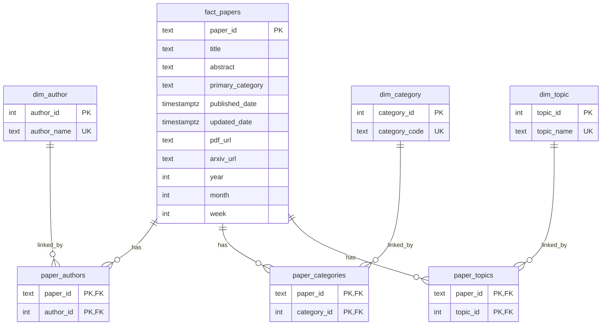

# Data Model

## Warehouse Tables

The ETL pipeline loads research paper data into a star-like warehouse model in Supabase PostgreSQL.

### `fact_papers`

One row per paper.

| Column | Type | Notes |
| --- | --- | --- |
| `paper_id` | `text` | Primary key |
| `title` | `text` | Not null in schema |
| `abstract` | `text` | Paper abstract |
| `primary_category` | `text` | Main arXiv category |
| `published_date` | `timestamptz` | Published timestamp |
| `updated_date` | `timestamptz` | Last updated timestamp |
| `pdf_url` | `text` | PDF link |
| `arxiv_url` | `text` | arXiv abstract URL |
| `year` | `int` | Derived from `published_date` |
| `month` | `int` | Derived from `published_date` |
| `week` | `int` | ISO week derived from `published_date` |

### `dim_author`

Unique author names.

| Column | Type | Notes |
| --- | --- | --- |
| `author_id` | `int` | Primary key |
| `author_name` | `text` | Unique |

### `dim_category`

Unique arXiv category codes.

| Column | Type | Notes |
| --- | --- | --- |
| `category_id` | `int` | Primary key |
| `category_code` | `text` | Unique |

### `dim_topic`

Unique detected topics from the transform stage.

| Column | Type | Notes |
| --- | --- | --- |
| `topic_id` | `int` | Primary key |
| `topic_name` | `text` | Unique |

## Bridge Tables

### `paper_authors`

Connects papers to authors.

| Column | Type | Notes |
| --- | --- | --- |
| `paper_id` | `text` | FK to `fact_papers.paper_id` |
| `author_id` | `int` | FK to `dim_author.author_id` |

Primary key: `(paper_id, author_id)`

### `paper_categories`

Connects papers to all arXiv categories associated with each paper.

| Column | Type | Notes |
| --- | --- | --- |
| `paper_id` | `text` | FK to `fact_papers.paper_id` |
| `category_id` | `int` | FK to `dim_category.category_id` |

Primary key: `(paper_id, category_id)`

### `paper_topics`

Connects papers to detected topics derived from the transform stage.

| Column | Type | Notes |
| --- | --- | --- |
| `paper_id` | `text` | FK to `fact_papers.paper_id` |
| `topic_id` | `int` | FK to `dim_topic.topic_id` |

Primary key: `(paper_id, topic_id)`

## Mermaid ER Diagram

## `etl_runs` Operational Metadata

The pipeline also depends on an `etl_runs` table for operational tracking. The ETL code inserts `start_time` and `status` when a run starts, then updates the same row at the end of the run with completion metrics and error details.

Columns used by the current implementation:

| Column | Meaning |
| --- | --- |
| `run_id` | Unique identifier for one ETL run |
| `start_time` | UTC timestamp when the run started |
| `end_time` | UTC timestamp when the run finished |
| `papers_fetched` | Number of papers fetched from arXiv for that run |
| `new_papers_loaded` | Number of new fact rows inserted into the warehouse |
| `duplicates_skipped` | Number of already-existing papers skipped during incremental load |
| `status` | Run state: `RUNNING`, `SUCCESS`, or `FAILED` |
| `duration_seconds` | Total run duration in seconds |
| `error_message` | Error text captured on failure |

Notes:

- `etl_runs` is referenced directly by `etl/monitoring/metadata.py`
- the repo's `sql/schema.sql` defines the warehouse tables but does not currently include the `etl_runs` DDL
- documentation for `etl_runs` is based on the active ETL code path and the verified operational context supplied with this project
